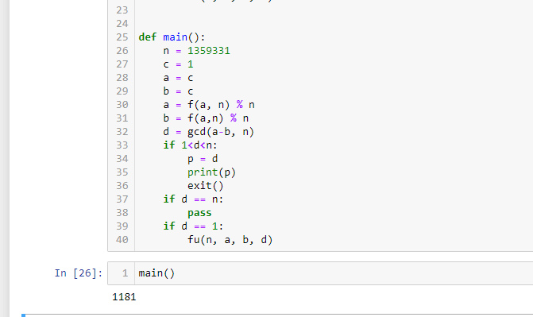

---
## Author
author:
  name: Владислав Носков
  email: 1032262531@rudn.ru
  affiliation:
    - name: Российский университет дружбы народов
      country: Российская Федерация
      postal-code: 117198
      city: Москва
      address: ул. Миклухо-Маклая, д. 6

## Title
title: "Отчёт по лабораторной работе №6"
subtitle: "Разложение чисел на множители"
license: "CC BY"
---


# Цель работы

Изучение задачи разложения на множители, изучение p-алгоритма Поллрада.

# Теоретические сведения

Разложение на множители — предмет непрерывного исследования в прошлом; и такие же исследования, вероятно, продолжатся в будущем. Разложение на множители играет очень важную роль в безопасности некоторых криптосистем с открытым ключом.

Согласно Основной теореме арифметики любое положительное целое число больше единицы может быть уникально записано в следующей главной форме разложения на множители, где $p_1, p_2, ..., p_k$ — простые числа и $e_1, e_2, ..., e_k$ — положительные целые числа.

$$n=p^{e_1}_1 * p^{e_2}_2 * ... * p^{e_k}_k$$

Поиск эффективных алгоритмов для разложения на множители больших составных чисел ведется давно. К сожалению, совершенный алгоритм для этого пока не найден. Хотя есть несколько алгоритмов, которые могут разложить число на множители, ни один не способен провести разложение достаточно больших чисел в разумное время. Позже мы увидим, что это хорошо для криптографии, потому что современные криптографические системы полагаются на этот факт. В этой секции мы даем несколько простых алгоритмов, которые проводят разложение составного числа. Цель состоит в том, чтобы сделать процесс разложения на множители менее трудоёмким.

В 1974 г. Джон Поллард разработал метод, который находит разложение числа $p$ на простые числа. Метод основан на условии, что $p – 1$ не имеет сомножителя, большего, чем заранее определенное значение $B$, называемое границей. Алгоритм Полларда показывает, что в этом случае

$$p = GCD(2^{B!}-1,n)$$

Сложность. Заметим, что этот метод требует сделать $B – 1$ операций возведения в степень $a = a^e mod n$. Есть быстрый алгоритм возведения в степень, который выполняет это за $2*1og_2 B$ операций. Метод также использует вычисления НОД, который требует $n^3$ операций. Мы можем сказать, что сложность — так или иначе больше, чем $O(B)$ или $O(2^n)$, где $n_b$ — число битов в $B$. Другая проблема – этот алгоритм может заканчиваться сигналом об ошибке. Вероятность успеха очень мала, если $B$ имеет значение, не очень близкое к величине $\sqrt{n}$.

## p-алгоритм Поллрада

* Вход. Число $n$, начальное значение $c$, функция $f$, обладающая сжимающими свойствами.
* Выход. Нетривиальный делитель числа $n$.

1. Положить $a=c, b=c$
2. Вычислить $a=f(a)(mod n), b=f(b)(mod n)$
3. Найти $d = GCD(a-b, n)$
4. Если $1<d<n$, то положить $p=d$ и результат: $p$. При $d=n$ результат: ДЕЛИТЕЛЬ НЕ НАЙДЕН. При $d=1$ вернуться на шаг 2.

# Выполнение работы

## Реализация алгоритма на языке Python

```
from math import gcd

ag = 1
bg = 1

def f(x, n):
    return (x*x+5)%n

def fu(n,a, b, d):
    a = f(a, n) % n
    b = f(f(b, n), n) %n
    d = gcd(a-b, n)
    if 1<d<n:
        p = d
        print(p)
        exit()
    if d == n:
        print("Не найдено")
    if d == 1:
        global ag
        ag = b
        fu(n, a, b, d)


def main():
    n = 1359331
    c = 1
    a = c
    b = c
    a = f(a, n) % n
    b = f(a,n) % n
    d = gcd(a-b, n)
    if 1<d<n:
        p = d
        print(p)
        exit()
    if d == n:
        pass
    if d == 1:
        fu(n, a, b, d)
```

## Контрольный пример

{ #fig:001 }

# Выводы

Изучили задачу разложения на множители и p-алгоритм Поллрада.

# Список литературы{.unnumbered}

1. [Алгоритмы тестирования на простоту и факторизации](https://habr.com/ru/post/521876/)
2. [P-метод Полларда](https://ru.bmstu.wiki/P-метод_Полларда)